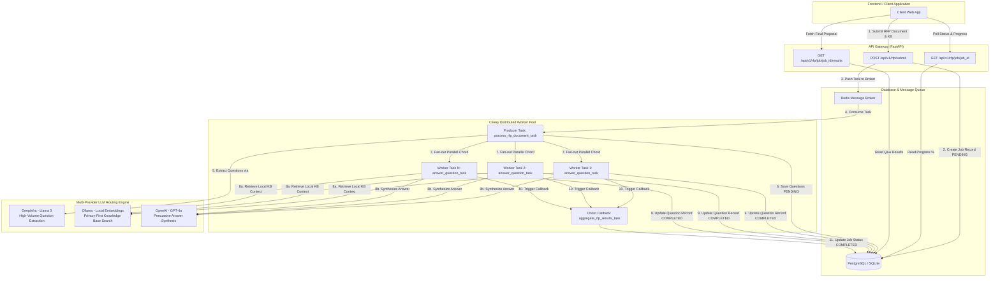

# 📄 Automated RFP & Tender Responder Engine (B2B SaaS)

[](https://www.python.org/)
[](https://fastapi.tiangolo.com/)
[](https://docs.celeryq.dev/)
[](https://www.langchain.com/)

An enterprise-grade, asynchronous event-driven **Automated RFP & Tender Responder Engine** built with **FastAPI**, **Redis**, **Celery**, **SQLAlchemy**, and a **Multi-Provider LangChain strategy** (routing across **DeepInfra**, **Ollama**, and **OpenAI**).

---

## 🏛️ System Architecture

The diagram below illustrates how data flows asynchronously from the web client, through the FastAPI gateway, onto the Redis message queue, and across parallel Celery workers orchestrating specialized multi-provider LLMs before persisting results into the database.



---

## ⚡ Multi-Step Worker Pipelines (Celery Chords / Groups)

1. **Document Ingestion & Question Extraction (`process_rfp_document_task`)**:
   - The producer task receives the raw RFP document text.
   - Routes question extraction to **DeepInfra (Llama 3)** to parse and extract 50+ individual requirement questions in seconds.
   - Writes `RFPQuestionResponse` records with state `PENDING` into the database.

2. **Parallel Fan-out (`answer_question_task`)**:
   - Constructs a **Celery Chord** header distributing `N` parallel tasks across Celery worker processes.
   - Each worker retrieves relevant company context using **Ollama local vector embeddings** (maintaining corporate data privacy).
   - Each worker routes context + question to **OpenAI (GPT-4o)** to generate a persuasive, compliant proposal answer.

3. **Chord Aggregation (`aggregate_rfp_results_task`)**:
   - Executes automatically as a callback once all parallel question tasks finish.
   - Calculates total execution duration, updates completion counts, and transitions job state to `COMPLETED`.

---

## 🤖 Multi-Provider LLM Strategy

| Task | Selected Provider | Model | Rationale |
| :--- | :--- | :--- | :--- |
| **Question Extraction** | **DeepInfra** | `meta-llama/Meta-Llama-3.1-8B-Instruct` | Ultra-fast, highly cost-effective extraction over 100+ page documents. |
| **Context Retrieval** | **Ollama** | `nomic-embed-text` / `llama3.2` | Runs 100% locally on internal infrastructure; prevents proprietary company knowledge base leakage. |
| **Answer Synthesis** | **OpenAI** | `gpt-4o` | Superior nuance, reasoning, and persuasive writing quality for winning multi-million dollar tenders. |

---

## 📊 Database Schema & State Management

The system tracks asynchronous job states via two main tables in SQLite/PostgreSQL:

- `rfp_jobs`:
  - `id` (UUID primary key)
  - `status`: `PENDING` ➔ `PARSING` ➔ `PROCESSING` ➔ `COMPLETED` / `FAILED`
  - `total_questions`, `completed_questions`, `execution_time_seconds`
- `rfp_question_responses`:
  - `id` (UUID primary key), `job_id` (foreign key)
  - `question_index`, `question_text`, `retrieved_context`, `generated_answer`
  - `provider_used`, `latency_seconds`, `status`

The frontend polls `GET /api/v1/rfp/job/{job_id}` to calculate real-time completion progress (`progress_percentage = completed_questions / total_questions * 100`).

---

## 🚀 Quick Start Guide

### Prerequisites
- Python 3.11+
- Redis Server (Running on `redis://localhost:6379/0` or via Docker)

### 1. Installation

```bash
cd rfp-responder-engine
pip install -r requirements.txt
```

### 2. Run Redis Broker (Docker)

```bash
docker run -d --name redis-rfp -p 6379:6379 redis:alpine
```

### 3. Start Celery Worker

```bash
celery -A tasks.celery_app worker --loglevel=info
```

### 4. Start FastAPI Gateway

```bash
python3 main.py
```

### 5. API Testing

Submit RFP Document:
```bash
curl -X POST "http://localhost:8000/api/v1/rfp/submit" \
     -H "Content-Type: application/json" \
     -d '{
       "title": "Cloud Platform Tender",
       "document_text": "Q1. What is your data encryption policy?\nQ2. Do you support SAML SSO?",
       "knowledge_base": "We enforce AES-256 encryption at rest and TLS 1.3 in transit. We support SAML 2.0 SSO via Okta."
     }'
```

Check Job Status:
```bash
curl "http://localhost:8000/api/v1/rfp/job/<JOB_ID>"
```

Get Complete Proposal Results:
```bash
curl "http://localhost:8000/api/v1/rfp/job/<JOB_ID>/results"
```

---

## 🧪 Automated Testing

Run the unit and integration test suite:

```bash
PYTHONPATH=. pytest tests/ -v
```
